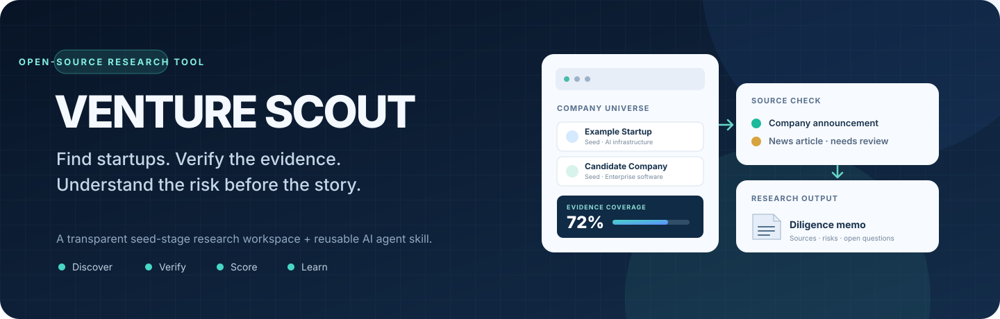
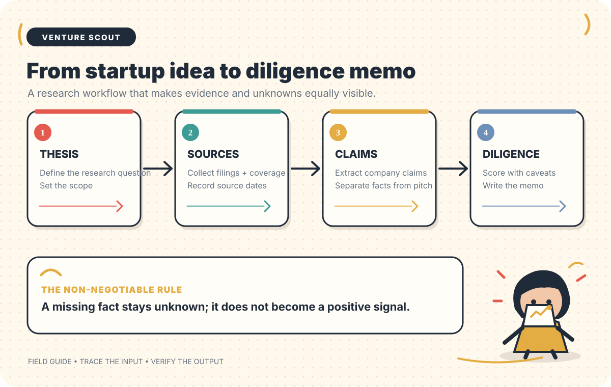
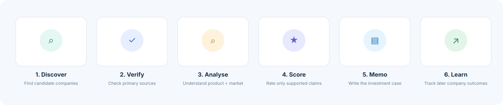
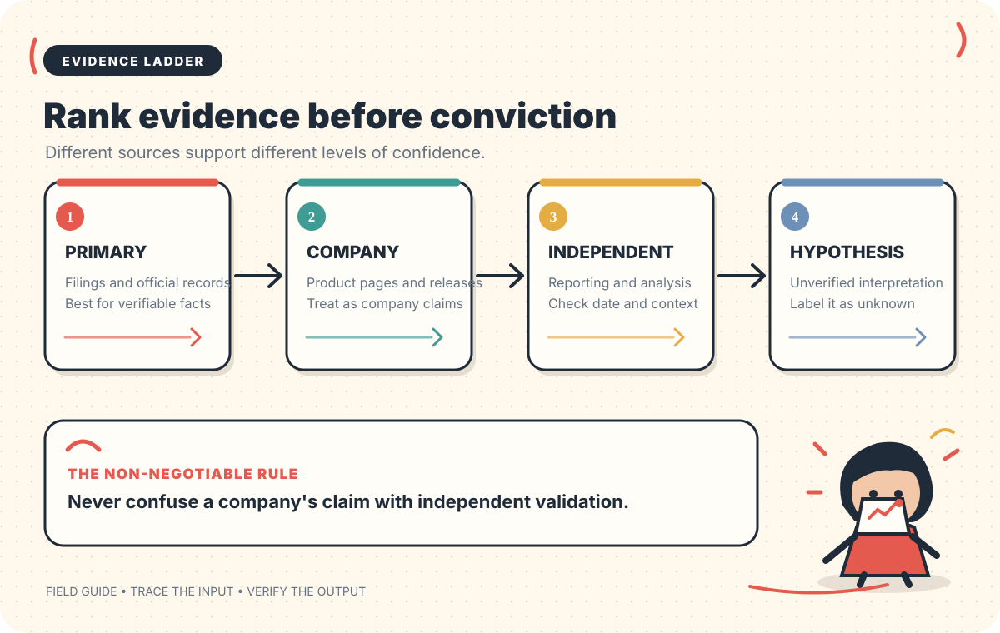
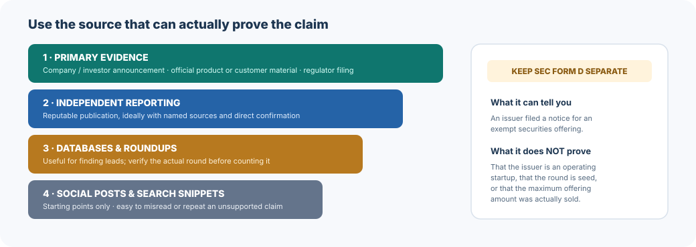

<div align="center">
  

  <p><strong>Find promising startups. Verify what is true. Understand what is still unknown.</strong></p>

  <p>
    <a href="https://github.com/yerageracharan/venture-scout/actions/workflows/tests.yml"></a>
    
    
    
    
    <a href="LICENSE"></a>
  </p>

  <p>
    <a href="#quick-start">Quick start</a> ·
    <a href="#guided-tour">Guided tour</a> ·
    <a href="#install-the-agent-skill">Install the AI skill</a> ·
    <a href="#how-the-scoring-works">Scoring methodology</a> ·
    <a href="#roadmap">Roadmap</a>
  </p>
</div>

---

## What is Venture Scout?

**[Documentation and maintainer map](docs/README.md)** · [Agent specification](AGENT_SPEC.md) · [Reusable skill](skills/venture-scout/SKILL.md)

Venture Scout is an open-source research workspace for finding and evaluating early-stage startups. It focuses on publicly announced **pre-seed and seed funding**, with a starter research universe centred on San Francisco.

Think of it as a research assistant with a strict rule: **a claim is not a fact just because it appears in a headline.**

A news article might say that a company raised $5 million. Venture Scout helps you investigate the questions behind that headline:

- Is this the correct company, and is it actually based in San Francisco?
- Was the financing really a seed round, or was it a SAFE, debt facility, extension, or something else?
- Did the company or an investor announce the round themselves?
- What does the company sell, who pays for it, and what proof of customer demand exists?
- What do we know, what are we assuming, and what evidence is still missing?

Venture Scout combines **three pieces**:

| Part | In everyday language | What it is built with |
|---|---|---|
| Research dashboard | A local website where you browse companies, discover funding stories, assess evidence, and export reports. | Python, Streamlit, SQLite, Pandas |
| Agent Skill | A reusable set of instructions that teaches a compatible AI assistant how to conduct Venture Scout research step by step. | Open Agent Skills format |
| MCP server | A bridge that lets an MCP-compatible AI model use Venture Scout's local company database and research tools. | Python, MCP, SQLite |

The dashboard works without an AI API key. The Agent Skill can use the host assistant's web-search tools, a connected MCP server, or only the local files available to it. The optional AI memo feature uses an OpenAI-compatible model endpoint.

## The research process



*Move from a defined thesis to source collection, claim extraction, and a caveated diligence memo.*


This is the full workflow, from discovering a company to learning what happened after its seed round.



### Why the order matters

1. **Discover** a possible funding announcement. Discovery results are leads, not confirmed deals.
2. **Verify** the funding stage, amount, date, investors, company identity, and headquarters against appropriate sources.
3. **Analyse** the product, market, founders, customers, go-to-market strategy, economics, competition, and risks.
4. **Score** only the dimensions supported by written evidence. Missing information stays unknown.
5. **Write a memo** that explains the thesis, risks, assumptions, open questions, and source trail.
6. **Learn** by recording later events such as a follow-on round, acquisition, or shutdown.

The point is not to produce the highest score. The point is to make the reasoning inspectable and show exactly where confidence is limited.

## Evidence before conclusions



*Rank primary records, company statements, independent coverage, and hypotheses separately.*


Venture Scout keeps the quality of a source separate from the attractiveness of a company. A funding headline can be a useful starting point, but it does not prove that a company has product-market fit or is a good investment.



The project uses explicit funding evidence labels:

| Label | Meaning | How to treat it |
|---|---|---|
| `announced_verified` | A funding announcement has been checked against a suitable primary source. | Eligible for verified announced-funding totals, subject to the project's inclusion checks. |
| `announced_unverified` | A news story, roundup, or other lead suggests a round, but primary verification is incomplete. | Keep it in the lead pipeline. Do not mix it into verified totals. |
| `sec_filing_only` | An SEC Form D filing has been found, but a seed-round announcement has not been confirmed. | Treat it as a regulatory filing signal, not automatically as a seed round. |
| `database_only` | The available evidence is a company/funding database entry. | Use as a lead and seek a primary source. |
| `user_entered` | The record was supplied manually. | Preserve its provenance and verify it before relying on it. |

**A Form D is not the same thing as a seed-round announcement.** It is a notice of an exempt securities offering. The issuer may be a fund or another type of entity, and the maximum offering amount is not necessarily the amount sold. See the [SEC's Form D explanation](https://www.sec.gov/resources-small-businesses/capital-raising-building-blocks/what-form-d).

---

## Features

### Research dashboard

- Search and filter the company universe by company, sector, and stage.
- Discover candidate funding articles through public Google News RSS results.
- Scan SEC Form D filings as a separate evidence stream.
- Record company facts, source links, analyst notes, and diligence ratings.
- Generate deterministic Markdown investment memos.
- Optionally draft an AI-assisted memo using a local or hosted OpenAI-compatible endpoint.
- Import and export company data as JSON or CSV.
- Record later company outcomes and compare patterns across the research cohort.

### Reusable Agent Skill

The `skills/venture-scout/` folder contains the portable `venture-scout` skill. It teaches an AI assistant to:

- Set a clear research mandate and geographic boundary.
- Search for candidate companies and funding announcements.
- Verify important claims using primary sources where possible.
- Keep publication dates separate from the date a funding event happened.
- Distinguish confirmed facts, company claims, third-party claims, hypotheses, and unknowns.
- Apply the nine-dimension diligence framework.
- Prepare an investment memo with a source register and concrete diligence questions.
- Avoid claiming complete coverage or predicting investment returns from a small sample.

### MCP tools for AI assistants

An MCP-compatible host can use nine local tools to list companies, retrieve profiles, score records, search news, save leads, generate memos, analyse the cohort, record outcomes, and scan Form D filings. See [`skills/venture-scout/references/mcp-tools.md`](skills/venture-scout/references/mcp-tools.md) for the full inventory.

---

## Quick start

You do not need an API key to run the dashboard, browse the starter dataset, use the deterministic scorecard, or create a standard Markdown memo.

### 1. Install Python

Use Python **3.10 or newer**. Confirm that Python and pip are available:

```bash
python --version
python -m pip --version
```

On Windows, `py` is also supported in the commands below.

### 2. Download the project

Open PowerShell, Terminal, or your preferred command line:

```bash
git clone https://github.com/yerageracharan/venture-scout.git
cd venture-scout
```

You can also download the repository as a ZIP from GitHub and extract it.

### 3. Create a virtual environment

A virtual environment keeps this project's Python packages separate from other projects on your computer.

**Windows PowerShell**

```powershell
py -m venv .venv
.venv\Scripts\Activate.ps1
```

**macOS / Linux**

```bash
python3 -m venv .venv
source .venv/bin/activate
```

If PowerShell blocks activation, use the Python executable inside `.venv` directly or follow Microsoft's guidance for your execution policy. Do not change system-wide security settings just to run this project.

### 4. Install the dependencies

```bash
python -m pip install --upgrade pip
python -m pip install -r requirements.txt
```

This installs the dashboard's required packages. The MCP package is optional and is installed separately later in this guide.

### 5. Create your local configuration

**Windows PowerShell**

```powershell
Copy-Item .env.example .env
```

**macOS / Linux**

```bash
cp .env.example .env
```

The default settings are enough to start. You can leave the optional AI and SEC settings untouched for now.

### 6. Launch Venture Scout

```bash
streamlit run app.py
```

Streamlit prints a local address in the terminal. Open that address in your browser; the default is usually `http://localhost:8501`.

On the first run, Venture Scout creates a local SQLite database at `data/venture_scout.db` and loads the starter research dataset if the database is empty. Your later edits are saved in that local database.

<details>
<summary><strong>Quick start commands — Windows, all together</strong></summary>

```powershell
git clone https://github.com/yerageracharan/venture-scout.git
cd venture-scout
py -m venv .venv
.venv\Scripts\Activate.ps1
py -m pip install --upgrade pip
py -m pip install -r requirements.txt
Copy-Item .env.example .env
streamlit run app.py
```

</details>

---

## Guided tour

Once the app opens, you will see five tabs. Here is what each tab is for and how to use it.

### 1. Company universe — browse the companies

This is your main research list. Search by company name, sector, or investor. Filter by sector and stage. Open a company profile to see its description, funding information, source links, screening status, and evidence coverage.

**What to do first:** open a company and inspect the source links. Do not treat a populated row as proof that every field is correct. The evidence status tells you how much verification has happened.

### 2. Discover funding — find possible deals

This tab has two discovery paths:

**Google News RSS**

1. Enter a search phrase such as `"San Francisco" startup seed round raised`.
2. Choose the maximum number of news results.
3. Set the minimum candidate round amount.
4. Select **Run funding discovery**.
5. Open the original article and check the company or investor announcement.
6. Add a promising candidate as an unverified lead so that it can be investigated later.

The parser extracts possible company names, stages, and amounts from article headlines and snippets. Those values are only clues. It can misread a headline, miss a company, or attach a round to the wrong entity.

**SEC Form D**

1. Set a filing-date range.
2. Add a real contact email to `SEC_USER_AGENT` in `.env` before scanning.
3. Select **Scan SEC Form D filings**.
4. Open the filing and inspect the issuer, location, entity type, date of first sale, total offering amount, amount sold, and amendment status.

The Form D scanner is separate from the news discovery feed. Do not classify a filing as a seed round without independent evidence for the company and financing stage. Follow the [SEC's fair-access guidance](https://www.sec.gov/search-filings/edgar-application-programming-interfaces).

### 3. Diligence workspace — build the actual company case

Create a new company or select one already in the database. Add the company facts, financing context, investors, source record, founder evidence, customer evidence, go-to-market notes, economics, and risks.

Then work through the scorecard. For every dimension you choose to rate:

1. Select a rating from 1 to 5.
2. Explain what evidence supports that rating.
3. Add the source URL or URLs where possible.
4. Leave the dimension unassessed if you do not have enough information.
5. Save the company and assessment.

The screen shows the weighted score, evidence coverage, screening status, and open diligence gaps. You can download a deterministic Markdown memo. You can also request an optional AI-assisted draft once a compatible model endpoint has been configured.

### 4. Cohort patterns — compare the research sample

This tab summarises verified announced funding, median verified round size, sector counts, investor frequency, and recorded company outcomes.

Read these numbers as **descriptions of the records in your database**, not as a prediction of which company will win. A small, manually selected, or incomplete cohort can be biased. The starter dataset does not magically become statistically representative just because it has a chart.

### 5. Data & methodology — inspect and export your work

Use this tab to review the research methodology, import company rows from CSV, and export the current company universe as JSON or CSV. Keep your source URLs and evidence labels when moving data between tools.

---

## How the scoring works

Venture Scout uses a transparent, nine-dimension seed-stage diligence rubric. Each dimension has a weight and a 1–5 rating. The analyst must provide an evidence note for a rating to count.

| Dimension | Weight | The simple question |
|---|---:|---|
| Market size & urgency | 20% | Is the problem important, timely, and connected to a real budget? |
| Founder-market fit | 15% | Does the team have a credible edge in understanding or solving this problem? |
| Traction quality | 15% | Are people actually using, paying for, and returning to the product? |
| Problem intensity | 10% | Is the existing problem painful enough that customers will change behaviour? |
| Product wedge & 10x value | 10% | Is there a clear first use case that is dramatically better than the alternative? |
| Go-to-market repeatability | 10% | Can the company repeatedly reach and convert the right customer? |
| Defensibility | 10% | What could make the advantage difficult to copy over time? |
| Capital efficiency | 5% | Can the company reach meaningful milestones without excessive capital? |
| Financing & round context | 5% | Does the financing make sense for the stage and the disclosed facts? |

### Rating scale

| Rating | Meaning |
|---:|---|
| 1 | Weak or contradicted by the available evidence |
| 2 | Plausible, but mostly supported by assertions or weak proxies |
| 3 | Some credible early evidence, with important unknowns remaining |
| 4 | Strong evidence, meaningful customer value, or a clear company edge |
| 5 | Exceptional evidence supported by multiple independent signals |

### Why evidence coverage appears next to the score

Imagine that a company scores 90/100 on the few dimensions you could investigate, but you have no evidence about customers, economics, or the founders. A 90 by itself would create a false sense of confidence.

Venture Scout therefore reports **evidence coverage**: the proportion of the rubric's total weight that has actually been assessed with a written evidence note. The score is normalised across assessed dimensions, while coverage makes the missing information visible.

| Screening result | Rule |
|---|---|
| `INSUFFICIENT EVIDENCE` | Less than 60% weighted evidence coverage **or** fewer than five dimensions assessed |
| `DEEP DIVE` | Score of 80 or higher, with sufficient evidence coverage |
| `WATCH` | Score from 65 to 79.9, with sufficient evidence coverage |
| `LOW PRIORITY` | Score below 65, with sufficient evidence coverage |

These are research-priority labels. They are **not** a probability of success, valuation, expected return, or recommendation to invest. The rubric is an independent synthesis of general diligence practices; it is not a proprietary framework from a16z or another venture firm.

For the complete methodology, read [`investment-framework.md`](skills/venture-scout/references/investment-framework.md).

---

## Optional AI-assisted memo writing

The research database, discovery feed, scorecard, and deterministic memo do not need an LLM. AI-assisted memo writing is optional.

The app sends the selected company record, scorecard, and diligence gaps to the OpenAI-compatible endpoint configured in `.env`. That endpoint can be a local model server or a hosted provider.

For example, an Ollama-compatible local endpoint might use:

```dotenv
LLM_BASE_URL=http://localhost:11434/v1
LLM_MODEL=qwen2.5:7b-instruct
LLM_API_KEY=
```

Use the exact model identifier exposed by your local server. If you use a hosted provider, enter its compatible base URL, model name, and API key. Restart the Streamlit app after changing `.env`.

**Privacy note:** company information and analyst notes in the selected record are sent to the endpoint when you request an AI memo. A local endpoint keeps that request on your machine/network; a hosted provider processes it under that provider's terms. Do not add confidential or restricted information unless you are comfortable with the endpoint's data-handling policy.

---

## Install the Agent Skill

The Agent Skill is separate from the Streamlit dashboard. It teaches an AI assistant the Venture Scout research method. It does not automatically give an AI model internet access, a subscription, SEC access, or a connection to your local database.

### Choose your environment

| Environment | Recommended setup | What you get |
|---|---|---|
| Claude.ai | Upload a ZIP of `skills/venture-scout/` in **Customize → Skills → Create skill → Upload a skill**. | The research workflow inside Claude. Code execution must be enabled for custom skills. |
| Claude Code | Run the installer below, or keep the repo's `.claude/skills/venture-scout/` copy in the project. | Skill discovery in Claude Code. |
| ChatGPT desktop / Codex CLI / IDE extension | Run the installer below, or use `.agents/skills/venture-scout/`. | Standalone skill support in ChatGPT desktop and Codex surfaces. |
| ChatGPT web Chat / Work | Package the skill in a ChatGPT plugin. A standalone Skill ZIP is not itself a web plugin. | The workflow can be distributed through a plugin. |
| Local model with MCP support | Start the Venture Scout MCP server and connect it in the model host. | Tools for querying the local database and supported research sources. |
| Local model with no tools | Add the provided system prompt and attach local data. | Analysis of the supplied information only; no live web discovery. |

Product support changes over time. Check the official [OpenAI skills documentation](https://learn.chatgpt.com/docs/build-skills), [OpenAI plugins documentation](https://learn.chatgpt.com/docs/plugins), and [Anthropic's custom skill instructions](https://support.claude.com/en/articles/12512198-how-to-create-custom-skills) for current interface and plan requirements.

### Option A — Claude.ai: create the upload ZIP

From the project root in Windows PowerShell:

```powershell
New-Item -ItemType Directory -Force .\dist\venture-scout | Out-Null
Copy-Item .\skills\venture-scout\* .\dist\venture-scout\ -Recurse -Force
Compress-Archive -Path .\dist\venture-scout -DestinationPath .\venture-scout-skill.zip -Force
```

The ZIP must contain one top-level `venture-scout/` folder, with `SKILL.md` inside it. Then:

1. Open Claude and go to **Customize → Skills**.
2. Select **+ → Create skill → Upload a skill**.
3. Upload `venture-scout-skill.zip`.
4. Enable the skill.
5. Start a new conversation and test it with the example prompt below.

### Option B — Claude Code

From the repository root:

```powershell
py skills/venture-scout/scripts/install_skill.py --target claude-code --scope user
```

This installs the skill to your user-level Claude Code skills folder. For a project-only installation:

```powershell
py skills/venture-scout/scripts/install_skill.py --target claude-code --scope project --project .
```

### Option C — ChatGPT desktop / Codex CLI / IDE extension

From the repository root:

```powershell
py skills/venture-scout/scripts/install_skill.py --target codex --scope user
```

For a project-only installation:

```powershell
py skills/venture-scout/scripts/install_skill.py --target codex --scope project --project .
```

**Important distinction:** current OpenAI documentation supports standalone skills in the ChatGPT desktop app, Codex CLI, and IDE extension. For ChatGPT web Chat and Work, skills are distributed inside plugins. Uploading a standalone skill ZIP to a normal ChatGPT web conversation does not install it.

### Test the skill

Try this prompt after installing it:

> Use Venture Scout to find San Francisco AI startups that announced seed rounds of at least $2 million in the last 24 months. Separate primary-source verified rounds from unverified leads. For every company, show the funding source, event date, publication date, HQ evidence, investors, and the biggest unanswered diligence question. Do not invent missing data.

For additional prompt examples and the full workflow, open [`skills/venture-scout/SKILL.md`](skills/venture-scout/SKILL.md).

---

## Connect a local AI model with MCP

MCP (Model Context Protocol) is a standard way for an AI application to call tools provided by another program. In this project, the MCP server exposes Venture Scout's local research functions to a compatible AI host.

### 1. Install the optional MCP dependency

Activate the project virtual environment, then run:

```bash
python -m pip install -r requirements-mcp.txt
```

### 2. Start the MCP server

From the repository root:

```bash
python -m venture_scout.mcp_server
```

The server uses standard input/output transport. It is normally launched and managed by the AI client; it is not a separate website that you open in a browser.

### 3. Add the server to your AI client's MCP configuration

The generic configuration below illustrates the information your client needs. The exact configuration file and supported fields vary by host, so follow that host's MCP instructions and replace the working directory with the absolute path to your local clone.

```json
{
  "mcpServers": {
    "venture-scout": {
      "command": "python",
      "args": ["-m", "venture_scout.mcp_server"],
      "cwd": "C:\\path\\to\\venture-scout",
      "env": {
        "VENTURE_SCOUT_DB": "data/venture_scout.db"
      }
    }
  }
}
```

Restart or refresh the AI client, then check that it can see the `venture_scout_*` tools. The tool list is documented in [`mcp-tools.md`](skills/venture-scout/references/mcp-tools.md).

### 4. Ask the model to use the local research tools

Example:

> Use the Venture Scout tools to list the companies in my local database. Show the funding evidence status and evidence coverage. Do not call an unverified lead a confirmed seed round.

### What MCP can and cannot do

The MCP server can read and update the local company database, search the configured news feed, generate memos, calculate scores, analyse recorded outcomes, and scan SEC Form D records when configured. The MCP tool server does not replace a browser-based research agent: use a web-search-capable host to validate claims against company and investor websites.

For SEC filing discovery, add a real contact email to `.env`:

```dotenv
SEC_USER_AGENT=VentureScout/0.1 (research contact: your-real-email@example.com)
```

Do not leave the example email in place when making SEC requests.

---

## Local model without MCP or web access

Some local models can only read a prompt and files. They cannot search the internet or call MCP tools. For that setup:

1. Open [`prompts/venture-scout-system-prompt.md`](prompts/venture-scout-system-prompt.md).
2. Copy its contents into your local model's system-prompt field.
3. Attach or mount the company data and research sources you want analysed, such as `data/research_seeds.json` and `data/starter_cohort.csv`.
4. Ask the model to analyse only the supplied information.

The prompt explicitly tells the model not to pretend it has searched the live web. Without web or MCP access, it can only work from data you provide.

---

## Data, storage, and privacy

- Company records are stored locally in SQLite. The default database path is `data/venture_scout.db`.
- The starter records are loaded from `data/research_seeds.json` when the local database is empty.
- The application does not require a Venture Scout account or a hosted backend.
- News discovery and SEC discovery make external network requests when you run them.
- The optional AI memo feature sends the selected company record to the configured LLM endpoint.
- Keep secrets in `.env`. Do not commit `.env`, API keys, private customer information, or restricted company material.
- Back up your SQLite database and exported JSON/CSV files if the research matters to you.

---

## Run the tests

The repository includes unit tests for scoring, data storage, cohort analysis, and source discovery, plus a validator for the Agent Skill package.

```bash
python -m unittest discover -s tests -v
python skills/venture-scout/scripts/validate_skill.py
python -m py_compile venture_scout/mcp_server.py
```

The GitHub Actions workflow runs the test and validation checks on supported Python versions. The workflow badge at the top shows the latest status on the `main` branch.

---

## Project structure

```text
venture-scout/
├── app.py                          # Streamlit dashboard
├── .env.example                    # Optional model, SEC and database settings
├── data/
│   ├── research_seeds.json         # Starter company records
│   ├── starter_cohort.csv          # Example cohort data
│   └── research_snapshot.md        # Research snapshot / context
├── docs/
│   └── images/                     # README diagrams and banner
├── prompts/
│   └── venture-scout-system-prompt.md
├── skills/
│   └── venture-scout/
│       ├── SKILL.md                # Canonical Agent Skill instructions
│       ├── agents/openai.yaml      # Optional agent UI metadata
│       ├── references/             # Research, scoring and memo guides
│       └── scripts/                # Installer and skill validator
├── .claude/skills/                 # Claude Code discovery copy
├── .agents/skills/                 # Codex / Agent Skills discovery copy
├── venture_scout/
│   ├── sources/                    # Google News RSS and SEC EDGAR connectors
│   ├── cohort.py                   # Cohort and outcome analysis
│   ├── llm.py                      # Optional OpenAI-compatible memo generation
│   ├── memo.py                     # Deterministic memo generator
│   ├── mcp_server.py               # Optional MCP server
│   ├── scoring.py                  # Evidence-weighted scorecard
│   └── store.py                    # SQLite persistence
├── tests/                          # Automated tests
├── SKILL_INSTALL.md                # Short skill installation guide
├── AGENT_SPEC.md                   # Agent behaviour specification
├── requirements.txt                # Dashboard dependencies
└── requirements-mcp.txt            # Optional MCP dependency
```

---

## Limitations and responsible use

Venture Scout is a research and screening tool, not an investment advisor or a substitute for professional diligence.

- **Coverage is incomplete by nature.** Private companies may not disclose rounds, and public sources may miss or misclassify them. The research universe is a sourced sample, not a complete list of all startups.
- **Discovery is not verification.** Google News RSS results are candidate articles. Headlines and snippets can be wrong or incomplete.
- **Funding labels require care.** SAFE financings, debt, extensions, venture rounds, funds, and exempt offerings are not interchangeable.
- **A company's own announcement has limits.** It can confirm what the company announced, but it does not independently prove revenue, retention, customer value, or product-market fit.
- **Scores are judgement aids.** They do not estimate the probability of success, fair value, or expected investment returns.
- **Cohort comparisons are descriptive.** Small samples, selected records, survivorship bias, and missing outcomes prevent causal or predictive conclusions.
- **No proprietary VC process is reproduced.** The scoring framework is an independent synthesis of public diligence practices and is not affiliated with a16z or any investment firm.

---

## Roadmap

Potential next improvements:

- Add a first-class source register so multiple claims can each have their own source, date, and verification status.
- Add a dedicated geographic verification panel for company headquarters.
- Add more discovery connectors while keeping each connector's evidence quality visible.
- Add timestamped research snapshots so later outcome analysis can be tested without look-ahead bias.
- Add better import validation and duplicate-company reconciliation.
- Add an optional, locally generated dashboard screenshot and short demo GIF once the interface is stable.

---

## References

- [OpenAI — Build skills](https://learn.chatgpt.com/docs/build-skills)
- [OpenAI — Skills and plugins](https://learn.chatgpt.com/docs/skills-and-plugins)
- [Anthropic — Create custom skills](https://support.claude.com/en/articles/12512198-how-to-create-custom-skills)
- [Anthropic — Use skills in Claude](https://support.claude.com/en/articles/12512180-use-skills-in-claude)
- [SEC — What is Form D?](https://www.sec.gov/resources-small-businesses/capital-raising-building-blocks/what-form-d)
- [SEC — EDGAR APIs and fair access](https://www.sec.gov/search-filings/edgar-application-programming-interfaces)
- [Streamlit — Documentation](https://docs.streamlit.io/)
- [Model Context Protocol — Documentation](https://modelcontextprotocol.io/)

## Contributing

Issues and pull requests are welcome. For changes to the research methodology, explain the evidence standard and how the change avoids mixing verified facts with unverified claims. Run the test and skill-validation commands before submitting a pull request.

## License

This project is licensed under the [MIT License](LICENSE).